# KuaiSAR_v2 EDA Report

## Overview

- Analysis date: 2026-03-31
- Data directory: `/Users/jeong-yonghun/Desktop/kuaisar/KuaiSAR_v2`
- Output figures directory: `/Users/jeong-yonghun/Desktop/kuaisar/reports/figures`
- Large files were profiled with chunked aggregation and sampled distributions to avoid full-memory loading.

## user_features.csv

- Rows: 25,877
- Columns: 5
- Unique users: 25,877

### Key distributions

| search_active_level | count |
|---|---:|
| 0 | 10,829 |
| 1 | 154 |
| 2 | 73 |
| 3 | 7,499 |
| 4 | 4,679 |
| 5 | 2,440 |
| 6 | 203 |

| rec_active_level | count |
|---|---:|
| 0 | 4,259 |
| 1 | 7,226 |
| 2 | 8,030 |
| 3 | 6,362 |

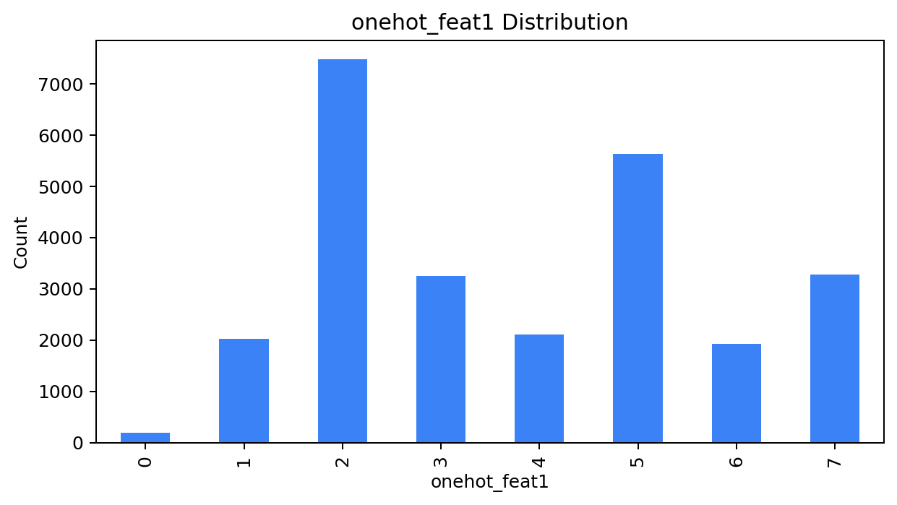

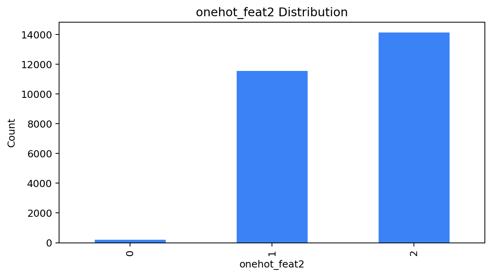

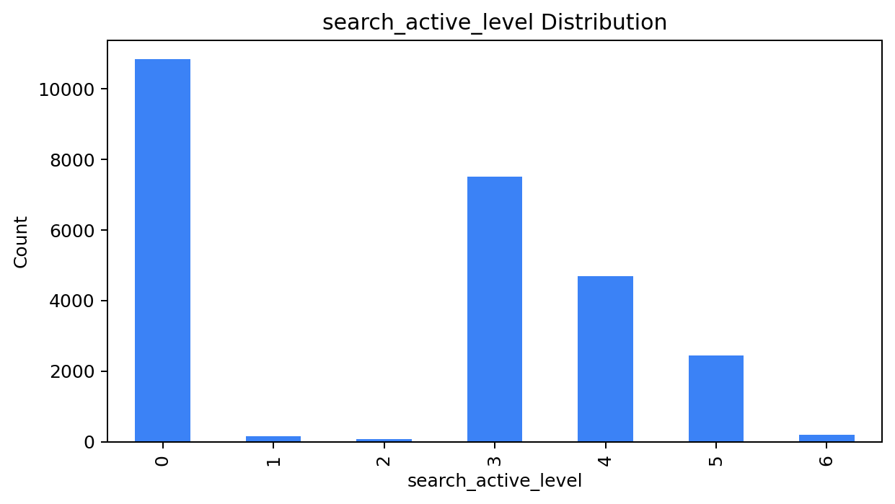

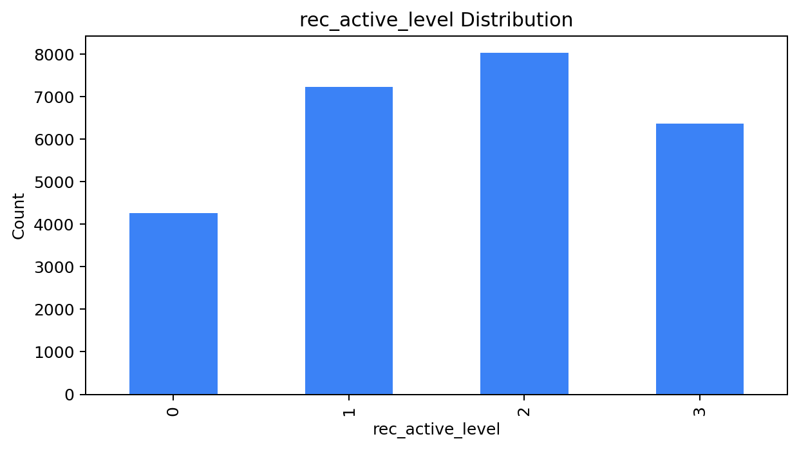

## social_network.csv

- Rows: 612
- Columns: 2
- Unique users involved: 576
- Unique source users: 465
- Unique target users: 457
- Average out-degree: 1.3161
- Average in-degree: 1.3392

### Top out-degree users

| user_id | follow_count |
|---|---:|
| 2415896 | 6 |
| 2404005 | 4 |
| 614462 | 3 |
| 2419770 | 3 |
| 2418440 | 3 |
| 2188920 | 3 |
| 2400625 | 3 |
| 2405622 | 3 |
| 2400731 | 3 |
| 2419893 | 3 |

### Top in-degree users

| user_id | follower_count |
|---|---:|
| 2407836 | 5 |
| 2408976 | 4 |
| 2406730 | 4 |
| 2413685 | 4 |
| 1620254 | 4 |
| 2423964 | 4 |
| 2414048 | 4 |
| 2423960 | 3 |
| 2423927 | 3 |
| 2400113 | 3 |

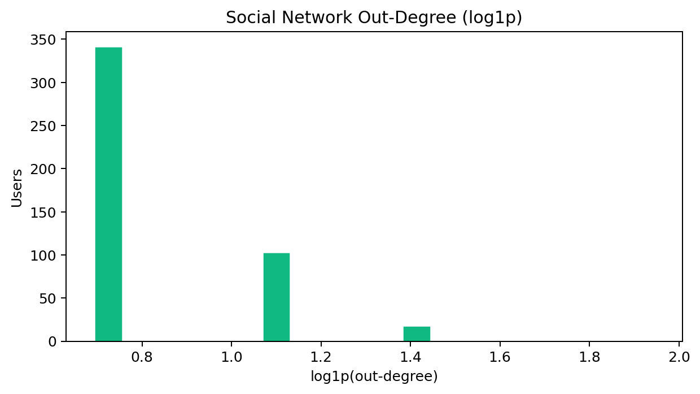

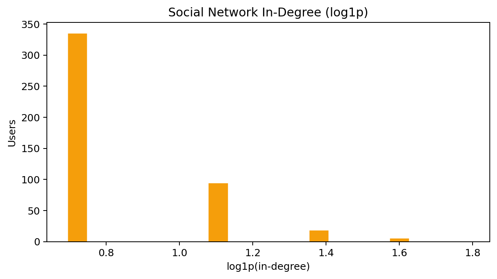

## item_features.csv

- Rows: 6,949,990
- Columns: 18
- Upload date range: 1970-01-01 00:00:00 to 2023-06-10
- Sample caption token mean: 21.7604
- Sample caption token median: 14.0000

### Item type distribution

| item_type | count |
|---|---:|
| NORMAL | 6,861,074 |
| AD | 63,634 |
| UNKNOWN | 25,259 |
| LIVEGAME_PLAYBACK | 23 |

### Top upload types

| upload_type | count |
|---|---:|
| LongImport | 2,006,570 |
| Kmovie | 1,284,341 |
| ShortImport | 1,118,509 |
| Web | 792,295 |
| LongPicture | 333,602 |
| PictureSet | 317,698 |
| ShortCamera | 287,012 |
| LongCamera | 280,259 |
| UNKNOWN | 205,773 |
| PictureCopy | 133,299 |

### Top first-level categories

| category | count |
|---|---:|
| Random clap | 621,530 |
| Film, Television, and Short Dramas | 545,572 |
| empty | 503,039 |
| game | 502,102 |
| pixiv | 457,381 |
| Food | 352,139 |
| Star Entertainment | 330,967 |
| music | 308,720 |
| Style | 277,646 |
| life | 254,264 |

### Top second-level categories

| category | count |
|---|---:|
| empty | 1,494,103 |
| Film and television dramas | 474,873 |
| Meaningless video | 356,653 |
| Selfie | 252,582 |
| animation | 222,704 |
| sing | 217,302 |
| star | 178,186 |
| Matching display | 177,366 |
| Funny joke | 170,605 |
| Social Information | 140,469 |

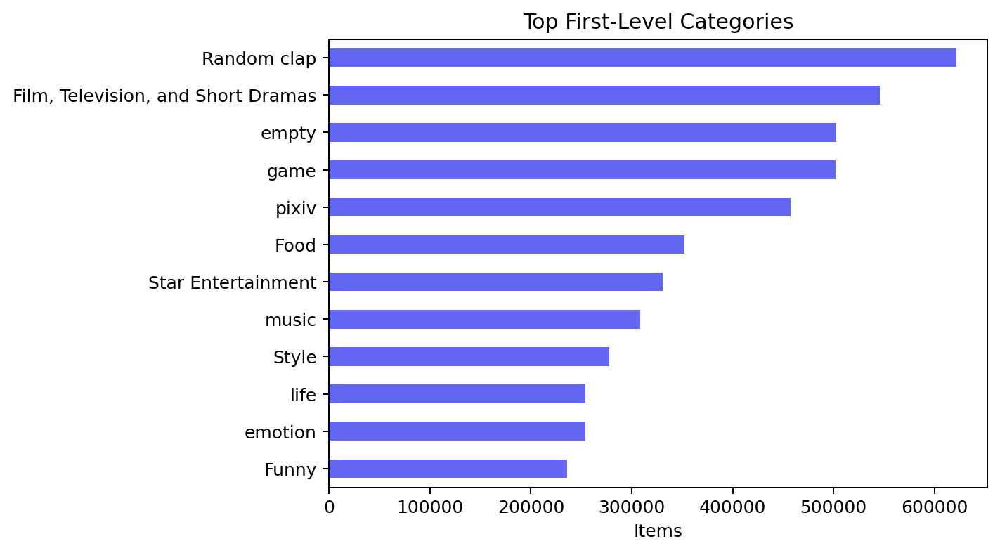

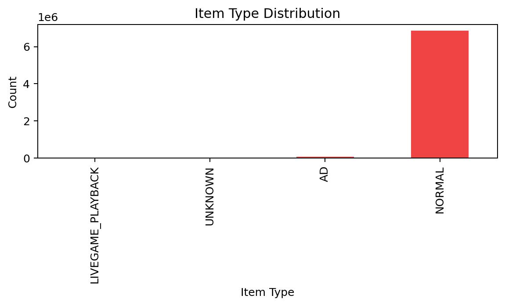

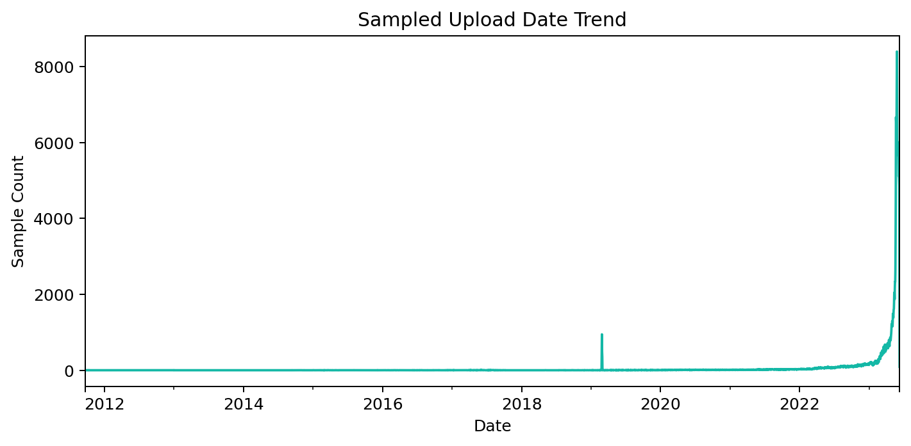

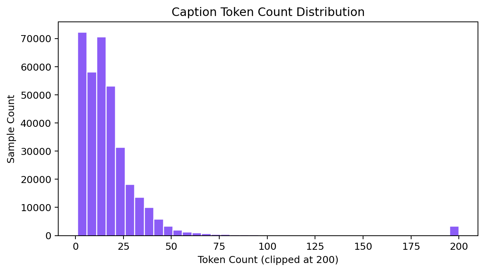

## rec_inter.csv

- Rows: 14,605,716
- Columns: 12
- Time range: 2023-05-22 to 2023-06-10
- Sample duration mean: 91,966.07 ms
- Sample duration median: 34,900.00 ms
- Sample playing time mean: 24,810.30 ms
- Sample playing time median: 6,900.00 ms
- Sample unique users: 24,117
- Sample unique items: 570,603

### Positive action rates

| action | rate |
|---|---:|
| forward | 0.0031 |
| like | 0.0315 |
| follow | 0.0045 |
| search_photo_related | 0.0000 |
| search | 0.0040 |
| click | 0.4960 |

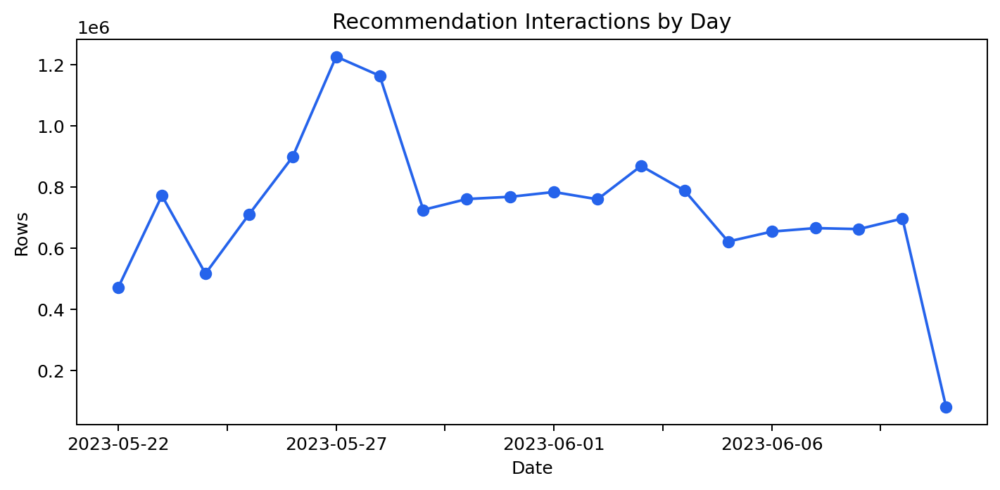

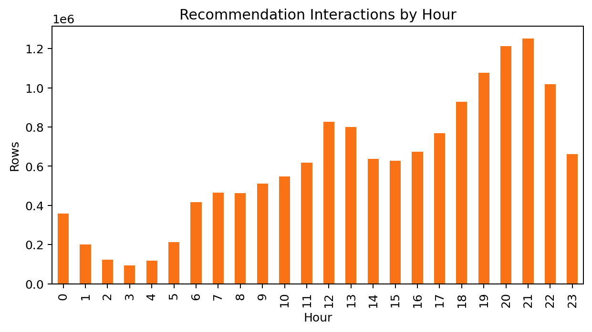

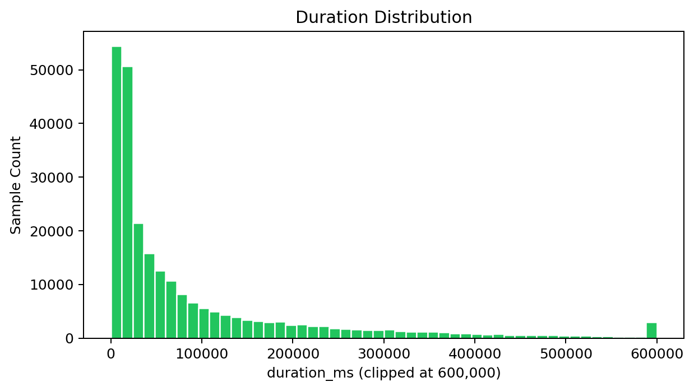

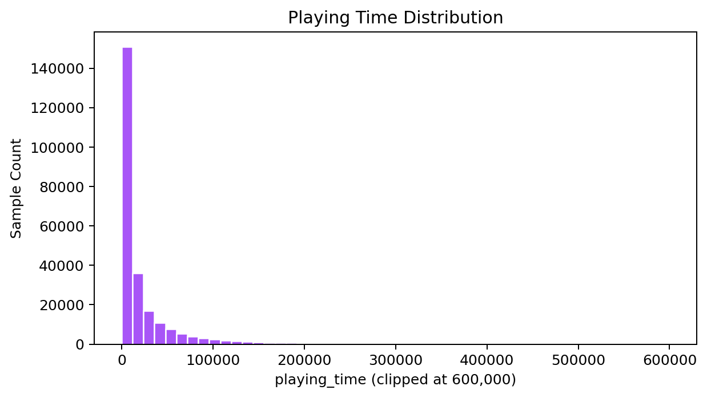

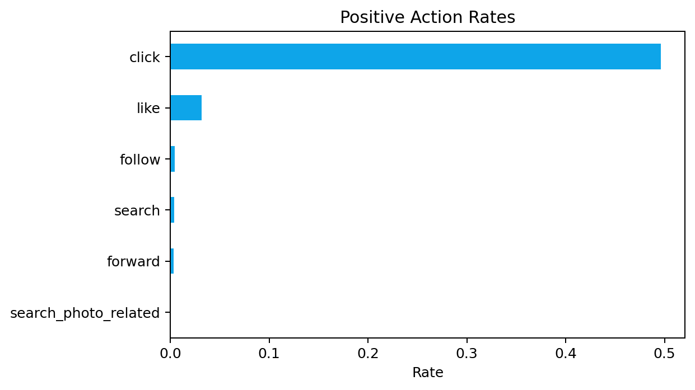

## src_inter.csv

- Rows: 5,059,169
- Columns: 9
- Time range: 2023-05-22 to 2023-06-10
- Sample average click_cnt: 0.1241
- Sample median click_cnt: 0.0000
- Sample average keyword token length: 3.1628
- Sample median keyword token length: 3.0000
- Sample unique (user_id, session_id) pairs: 157,489

### Search session source counts

| source | count |
|---|---:|
| USER_INPUT | 1,321,985 |
| RELATED_FEED_QUERY | 266,860 |
| TRENDING | 427,618 |
| UNKNOWN_PAGE | 521,914 |
| SUGGESTION | 1,500,060 |
| HISTORY | 848,834 |
| PLACEHOLDER | 171,862 |
| UNKNOWN_ENUM_VALUE_SearchFromPage_60 | 19 |
| SEARCH_POPULAR_POPUP | 17 |

### Search item type counts

| item_type | count |
|---|---:|
| VIDEO | 3,623,103 |
| IMAGE_ATLAS | 821,762 |
| UNKNOWN | 156,813 |
| USER | 140,708 |
| LIVE | 85,017 |
| COMMODITY | 52,373 |
| ADVERT | 175,282 |
| MUSIC | 4,111 |

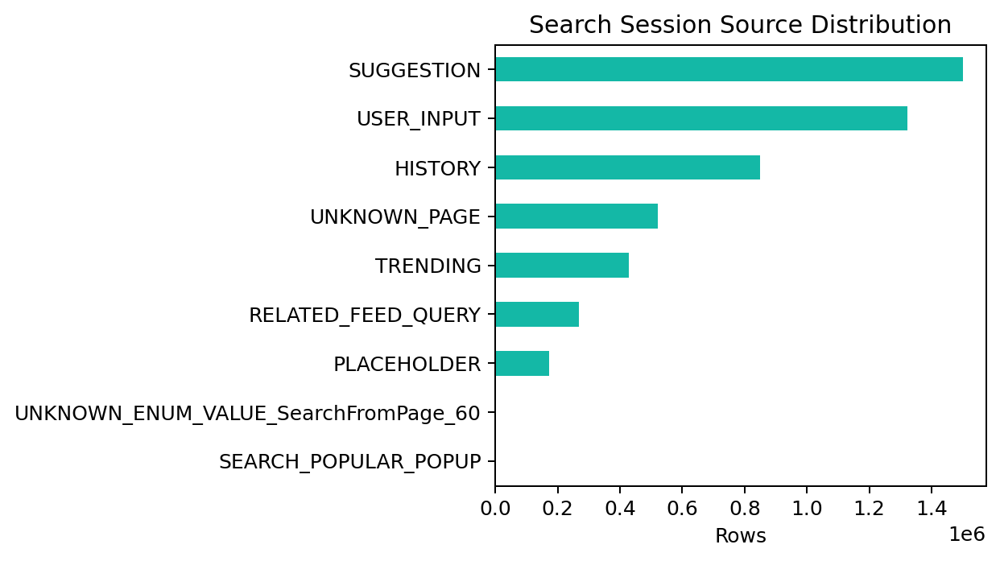

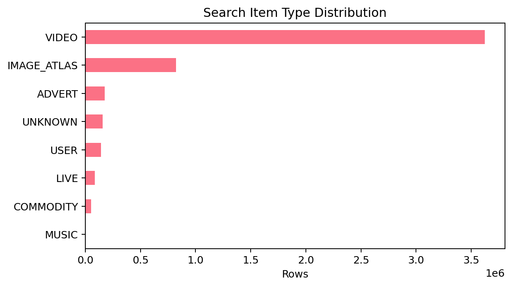

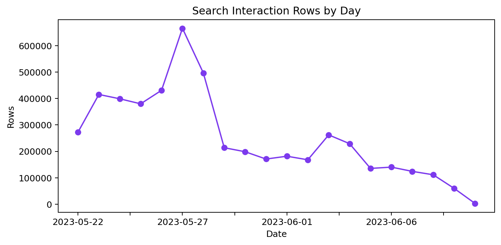

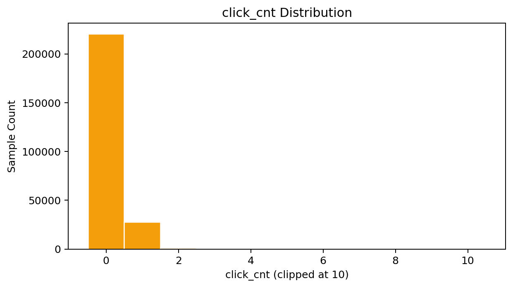

## Consolidated Findings

- `item_features.csv` is the largest entity table and shows a heavy concentration in a few high-level categories, while captions are highly variable in token length.
- `rec_inter.csv` is a dense interaction log with very low positive engagement rates relative to exposure volume, which is typical for implicit-feedback recommendation data.
- `src_inter.csv` captures search-result impressions rather than only clicks, so `click_cnt` should be treated as a relevance/engagement label, not a row existence indicator.
- `social_network.csv` is tiny compared with the interaction tables, suggesting it is likely an auxiliary graph feature rather than a core supervision source.
- `user_features.csv` appears to contain compact categorical/ordinal profile features rather than rich demographics.

## Output

- Markdown report: `/Users/jeong-yonghun/Desktop/kuaisar/reports/kuaisar_v2_eda.md`
- Figures: `/Users/jeong-yonghun/Desktop/kuaisar/reports/figures`
